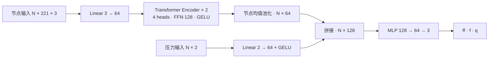
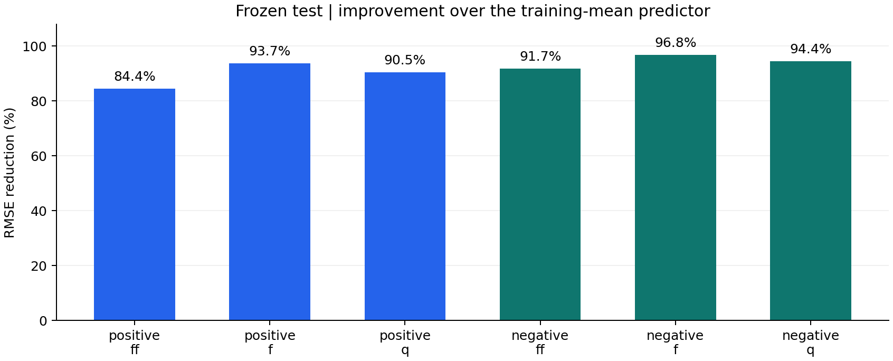
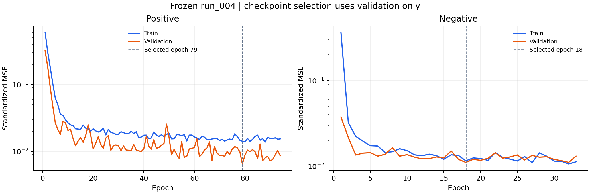

# 深海柔性密封性能预测 · Seal Transformer

**面向密封工况的多输出回归：从数据审计、关联分组到双 Transformer 训练与冻结测试。**

PyTorch regressors for deep-sea flexible seal performance, with auditable data preparation, leakage-aware splits, and independently evaluated positive/negative models.

[](https://github.com/HardyYip/deep-sea-seal-transformer/actions/workflows/ci.yml)


本项目根据两个全局压力和 221 个节点的三通道信息，预测 `ff`、`f`、`q` 三个工况级输出。`positive`、`negative` 分别使用结构相同、参数独立的模型；推理时另计算摩擦力 `ff + f`。项目覆盖原始文件审计、清洗证据复核、可追溯划分、训练集标准化、GPU 训练、模型保存与无目标列推理。

已完成的 `run_004` 实验使用 **2,090 条记录、302 条留出测试记录**；六个“分组 × 目标”的测试 R² 为 **0.9754–0.9990**。测试与训练/验证的已知工况及关联组隔离，但不属于外部独立采集数据。结果适用于当前数据范围内、具备相同节点输入的预测。

> 公开仓库包含核心代码、配置、汇总指标和学习曲线。原始研究数据、逐样本预测、拟合缩放参数和真实模型权重不随仓库发布。没有私有数据也可以运行下文的合成端到端示例；完整复现实验成绩需要取得原始数据授权。

## 项目解决的问题

原始数据按分组和压力等级分散在 CSV/XLSX 中，存在异常目标及共享节点状态。若直接拼接、逐行随机划分，再对全量数据拟合标准化，容易造成数据泄漏和难以追溯的评价结果。

本项目把这些问题落实为可执行的流程约束：

- **来源可追溯**：只合并 `*_training.csv`，生成稳定 `sample_id`、源文件和源行号，检查列结构、数值有效性及源文件 SHA-256。
- **清洗保留证据**：异常保留原值并记录处置；3 条 negative 工况暂时排除，不以取绝对值、插值或平均目标掩盖异常。
- **关联组隔离**：识别到 11 条共享完整节点输入的记录，将其放入同一分区；同工况、相同输入及已知关联组不得跨 train/validation/test。
- **训练与评价隔离**：每组仅用 train 拟合标准化，validation 选 checkpoint，test 通过单独命令评价，并拒绝覆盖已有测试结果。
- **可运行的工程链路**：提供 CPU/GPU 实际前向与反向预检、端到端合成验收、checkpoint 指纹核验、无目标列 CSV 推理和 GitHub Actions CPU 检查。

## 数据与任务定义

一行对应一个工况，**221 个节点共同构成一个样本**。原始每行 668 列，其中 665 列为输入，3 列为监督目标。

| 数据 | 模型接口 | 列顺序 / 含义 |
|---|---|---|
| 节点特征 | `[N, 221, 3]` | 每个节点为 `[xi, yi, cpressi]` |
| 全局压力 | `[N, 2]` | `[p_system, p_ocean]`，原表单位 MPa |
| 目标 | `[N, 3]` | `[ff, f, q]`，原表单位分别为 N、N、mm³/s |
| 摩擦力 | 推理后计算 | 在原尺度计算 `ff_prediction + f_prediction` |

原表按 `x1…x221`、`y1…y221`、`cpress1…cpress221` 三个块存放。代码按整数节点编号读取各块，再沿通道维堆叠，避免直接 reshape 造成节点错位。`y1…y221` 是输入，`ff/f/q` 均不进入输入。

`positive/negative` 沿用来源分组，不作为分类标签，也不改写压力符号。目标保留原正负号。节点变量的精确物理定义、单位、坐标系与跨工况对应关系仍待提供者确认。

## 模型结构



每个分组的模型有 **75,843 个参数**。节点自注意力提取节点间关系，均值池化后与全局压力分支融合。输出层为线性层，允许负数和零；两组模型不共享权重，也不合并训练。

模型没有加入时间位置编码或节点编号嵌入。在推理模式下，对完整节点三元组整体重排，输出保持一致。这是尚未确认拓扑时采用的建模选择，也意味着当前模型没有显式利用节点邻接关系。实现见 [模型代码](models/seal_transformer.py)，接口说明见 [models/README.md](models/README.md)。

## 数据审计与实验划分

原始建模池包括 28 个 training CSV：positive 1,049 条、negative 1,044 条。配套普通 CSV 和 2,095 个 XLSX 用于来源与目标核对，不重复拼入建模池。

初始按 `p_system` 分层、以工况组抽样，seed=42，目标比例为 70% / 15% / 15%。发现共享节点后进行关联修正；negative 的零海压边界记录按事先记录的方案分配为 train 5 / validation 2 / test 2。最终 v2 计数如下：

| 分组 | Train | Validation | Test | 纳入合计 |
|---|---:|---:|---:|---:|
| positive | 738 | 158 | 153 | 1,049 |
| negative | 740 | 152 | 149 | 1,041 |
| 合计 | 1,478 | 310 | 302 | **2,090** |

negative `(p_system, p_ocean)=(15,0)、(20,0)、(25,0)` 暂时排除，原始值保留；其中前两条为已标记的高风险 `ff` 异常，第三条同样按项目决定暂时排除。negative `p_system=65`、`p_ocean=60…65` 的 11 条共享节点记录全部归入 train。划分修正、边界方案与排除均在最终训练及冻结测试之前确定；不是根据测试误差筛样本。

数值和源表对照检查不等于完整物理审核。实验数据明确标记为 `user_authorized_experiment`，`physical_review_status=not_fully_verified`。处理过程与复现要求见 [数据说明](docs/DATA.md)。

## 已冻结的测试结果

以下来自已保存的 **run_004 / v2** 测试指标文件。标准化仅由 train 拟合；训练优化标准化三目标 MSE；结果逆变换到原单位后，逐目标计算 MAE、RMSE、R²。

| 分组 | 目标（单位） | MAE ↓ | RMSE ↓ | R² ↑ |
|---|---|---:|---:|---:|
| positive | ff（N） | 0.02808 | 0.05794 | 0.97538 |
| positive | f（N） | 1.02967 | 1.54040 | 0.99603 |
| positive | q（mm³/s） | 0.00820 | 0.01198 | 0.99097 |
| negative | ff（N） | 0.01536 | 0.03321 | 0.99302 |
| negative | f（N） | 1.55050 | 2.24560 | 0.99896 |
| negative | q（mm³/s） | 0.00578 | 0.00769 | 0.99687 |

对照基线为**仅使用训练集目标均值的常数预测器**。六项测试 RMSE 相对该基线降低约 **84.4%–96.8%**。目前未完成与 MLP、树模型或其他 Transformer 的系统对比，不能据此认定 Transformer 是最优模型。



| 训练设置 | positive | negative |
|---|---:|---:|
| 学习率 | 0.0003 | 0.001 |
| 最佳 epoch | 79 | 18 |
| 实际训练 epoch | 94 | 33 |

共用 AdamW、weight decay=1e-4、batch size=32、patience=15、dropout=0.1、最大 100 epochs、seed=42。实际实验使用 Python 3.11、PyTorch 2.13.0+cu130 和 RTX 5070 Laptop GPU。



完整数值、validation 指标、均值基线和文件指纹见 [汇总 JSON](docs/results/run_004_summary.json)；图表可从公开汇总数据重建，未重新运行测试集评价。

## 快速运行：无需原始数据

在 Python 3.11 环境中，先安装依赖，再执行合成验收。以下命令不会读取原始研究数据，也不会生成真实业务模型。

```bash
git clone https://github.com/HardyYip/deep-sea-seal-transformer.git
cd deep-sea-seal-transformer
python -m venv .venv
# Windows PowerShell: .venv\Scripts\Activate.ps1
# Linux / macOS: source .venv/bin/activate
python -m pip install -r requirements.txt
python scripts/check_models.py
python scripts/check_training_pipeline.py --device cpu
```

合成端到端检查为两个分组各运行 2 epoch，覆盖节点对齐、仅 train 标准化、目标逆变换、权重保存重载、无目标列推理、摩擦力求和及泄漏/重复测试拦截。临时模型自动清理，检查摘要写入 `outputs/model_checks/pipeline_checks.json`。合成示例用于验证软件流程，不代表真实模型精度。

GPU 用户可在已有兼容 PyTorch 环境中运行：

```bash
python scripts/check_environment.py --device cuda
python scripts/check_training_pipeline.py --device cuda
```

GPU 预检会实际执行 Transformer 前向与反向，不只检查 CUDA 是否可见；失败时会报错，不静默转为 CPU。安装与完整命令见 [训练运行说明](models/TRAINING.md)。

## 使用授权数据训练与推理

原始数据需按 [数据说明](docs/DATA.md) 放置，完成审计与证据复核后，生成 v2 实验包。以下命令使用两套独立配置，并为新实验使用新的运行目录：

```bash
python scripts/train_models.py --device cuda --data outputs/training_data/v2 --check-data
python scripts/train_models.py --device cuda --data outputs/training_data/v2 --config scripts/training_positive.json --group positive --output outputs/training/my_run
python scripts/train_models.py --device cuda --data outputs/training_data/v2 --config scripts/training_negative.json --group negative --output outputs/training/my_run
```

训练命令不会自动评价 test。最终评价、checkpoint 文件说明及推理命令见 [训练运行说明](models/TRAINING.md)。`run_004` 的测试结果已冻结，不作为后续调参依据。若继续基于已见测试结果开发模型，需要另设未使用的最终评价数据。

```bash
python scripts/predict.py --device cuda --run outputs/training/my_run/positive --input new_positive.csv --output outputs/predictions/positive.csv
```

预测 CSV 需要全部 665 个输入列，不需要 `ff/f/q`。输出为原尺度 `ff_prediction`、`f_prediction`、`q_prediction` 和 `friction_prediction`。**只提供两个压力，不能调用本模型完成预测。**

## 仓库结构

```text
models/
  seal_transformer.py          双模型结构与输入约束
  data.py                     manifest 对齐、缩放和原尺度指标
  runtime.py                  CPU/CUDA 实际运行预检
scripts/
  prepare_data.py              来源审计、原值合并与初始划分
  review_data_evidence.py      CSV/XLSX 证据与共享节点复核
  finalize_cleaning_review.py  关联组修正、边界分层与排除
  prepare_training_bundle.py   版本化实验数据包
  train_models.py              训练、早停与单独 test 评价
  predict.py                  无目标列推理
  check_*.py                  模型、流程与数据验收
  training_{positive,negative}.json
  export_public_results.py    从私有冻结产物导出汇总字段
  plot_public_results.py      从公开汇总结果生成图表
docs/
  DATA.md                     数据格式、审核与公开范围
  PROJECT_NOTES.md            项目贡献说明与简历表述参考
  results/                    冻结指标和逐轮汇总损失
  figures/                    可重建的结果图
.github/workflows/ci.yml       无私有数据的 CPU 自动检查
```

## 结果的适用边界与后续工作

- 当前测试为已覆盖压力范围内的留出工况评价，没有验证整级压力留出、域外工况或更深海域外推。
- 节点输入是必要条件；其在新工况下的获取成本仍待明确，当前结果应理解为给定相应节点状态后的代理回归。
- 导出文件未提供完整残差、容差与求解终止证据；已有节点收敛说明不足以证明全部工况与目标的物理有效性。
- 当前只有一个固定种子的最终实验，未报告多种子波动、置信区间、完整消融或系统模型比较；完整排除其他来源关联仍需要数据提供者补充信息。
- 后续可补充 MLP/树模型基线、节点/压力分支消融及独立新数据评价。后续实验应保持新的最终评价集隔离。

用于简历和面试的事实性表述见 [项目说明](docs/PROJECT_NOTES.md)。
